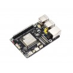
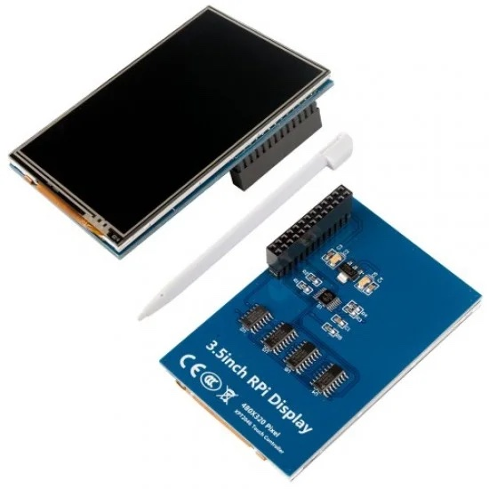

# ESP32-P4 + 3.5inch RPi Display (ILI9486, XPT2046 touch)

**The cheap 3.5" touchscreen made for the Raspberry Pi, running on an ESP32-P4. No Pi, no Linux.**

<table align="center">
  <tr>
    <td align="center"></td>
    <td align="center"></td>
  </tr>
  <tr>
    <td align="center">Waveshare ESP32-P4-Module-DEV-KIT</td>
    <td align="center">3.5inch RPi Display (MPI3501)</td>
  </tr>
</table>

## The idea

The 3.5inch RPi Display is one of the most common Raspberry Pi add-ons. It is a 480x320 colour
screen with resistive touch and a stylus, and it sits right on top of the Pi's 40-pin header. On a
Pi it only works through a Linux kernel overlay and the seller's install script.

The **Waveshare ESP32-P4-Module-DEV-KIT** copies the Raspberry Pi's 40-pin header, with power and
ground in the same places. So the same screen plugs straight onto it, with no adapter or wires.

This project makes the screen work there, on a microcontroller, with nothing in between:

- A small ESP-IDF driver talks to the screen directly. It draws its first frame 0.8 s after reset
  and redraws the full screen about 11 times a second.
- A touch calibrator: tap five crosses once, and touches land where your finger is from then on.
- A ready-to-flash test tool, so you can check your screen in a minute without installing anything.

It suits dashboards, gauges, control panels, radio displays or anything else where an ESP32 needs
a touchscreen, and maybe you already have this one from an old Pi project. The SDR receiver it was
built for shows a live spectrum and waterfall on it.

### Is this my screen?

Look at the back of the board. It should say **3.5inch RPi Display**, 480x320, XPT2046 touch
controller, and carry a row of **four small logic chips**, as in the photo above. Those chips form
the 16-bit interface this driver speaks. lcdwiki calls it the **MPI3501**. The same design is often
listed as "3.5 inch Raspberry Pi LCD (A)", "Waveshare-style 3.5 inch RPi LCD" or "goodtft LCD35".

3.5" Pi screens without those chips, such as plain-SPI ST7796 or ILI9488 boards, use a different
protocol. This driver won't run them as it is.

**How the port works**, including pin translation, the 16-bit bus quirk, the init sequence and why
the calibration is affine: [docs/PORTING.md](docs/PORTING.md).

## Flash the prebuilt tool (no toolchain needed)

1. Plug the panel onto the kit's 40-pin header, pin 1 to pin 1 (the square pad at the 3V3 end).
2. Connect the kit's **USB TO UART** Type-C port to your computer.
3. Find your chip revision:
   ```bash
   esptool.py --chip esp32p4 -p PORT flash_id
   ```
   The output contains `Chip is ESP32-P4 (revision vX.Y)`.
4. Download the matching image from the [latest release](https://github.com/John-ODell/esp32-p4-3.5-inch-rpi-display/releases/latest). Use `-rev1` for revision
   v1.x (early kits) and `-rev3` for v3.1 or later. Then flash it:
   ```bash
   esptool.py --chip esp32p4 -p PORT -b 921600 write_flash 0x0 p4-rpi-display-1.0.0-rev1.bin
   ```
   `PORT` is something like `/dev/cu.usbmodem…` on macOS, `/dev/ttyACM0` on Linux, or `COM5` on Windows.
   Flashing the whole image clears any calibration saved earlier.

Check downloads against `SHA256SUMS` on the release page. Web flashers can read
`workbench-manifest.json` from the same page: it lists each image's URL, flash address, size,
SHA-256 and the chip revisions it boots on.

## What the tool does

1. **Speed test.** It fills the screen red, green and blue and times each fill, about 93 ms per frame.
2. **Colour bars** with the measured frame rate. Hold the screen now to force a new calibration.
3. **Touch calibration** runs on first boot. Tap the centre of five crosses: four corners, then the
   centre. A stylus or fingernail works best. If one tap is clearly off, it asks again. The result is
   saved to flash and printed on the serial console (115200 baud) as a line you can paste into your own code:
   ```c
   touch_cal_t cal = { -0.003227f, -0.133795f, 534.647f, -0.083709f, 0.000536f, 325.778f };
   ```
4. **Touch tester**:
   - Drag to draw.
   - The top line shows the mapped x/y, the raw readings and the pressure.
   - Tap one of the five grey crosses to see how far off the touch lands. Green means 4 px or less,
     orange 8 px or less, red more than that.
   - Bottom buttons: **CLEAR**, **RECALIBRATE**, and **COLOURS** (colour bars, tap to go back).

## Use the driver in your own project

Copy `components/rpi_display` into your project's `components/` folder.

```c
#include "rpi_lcd.h"
#include "rpi_text.h"
#include "xpt2046.h"
#include "touch_cal.h"

nvs_flash_init();                       // calibration lives in NVS
rpi_lcd_init();
xpt2046_init();                         // shares the LCD's SPI bus, own CS

touch_cal_t cal;
if (touch_cal_load(&cal, NULL) != ESP_OK) touch_cal_run(&cal, NULL);   // interactive, saves itself

rpi_lcd_fill_rect(0, 0, 480, 320, RGB565(0, 0, 0));
rpi_lcd_text(10, 10, "hello", RGB565(255, 255, 0), RGB565(0, 0, 0), 2);

uint16_t rx, ry, rz;
int x, y;
if (xpt2046_read_raw(&rx, &ry, &rz)) touch_cal_map(&cal, rx, ry, &x, &y);
```

| Call | Does |
|---|---|
| `rpi_lcd_fill_rect`, `rpi_lcd_blit` | fill or copy RGB565 pixels; `blit` takes native-order `uint16_t` |
| `rpi_lcd_set_window` + `rpi_lcd_push_pixels_be` | stream big-endian pixels from a DMA-capable buffer |
| `rpi_lcd_text`, `rpi_lcd_textf` | 8x16 text at scale 1 or 2, background painted |
| `xpt2046_pressed`, `xpt2046_read_raw` | touch IRQ state; median-of-5 raw 12-bit readings |
| `touch_cal_run/load/save/map` | 5-point affine least-squares calibration, which handles swapped or mirrored axes |

`idf.py menuconfig`, under **MPI3501 3.5in RPi display**, sets:

- every GPIO, with defaults for direct plug-in on the P4 kit
- the SPI clock (32 MHz requested, 26.67 MHz delivered on the P4)
- a 180° rotation. Recalibrate after you change it.

## Pins (direct plug-in on the ESP32-P4-Module-DEV-KIT)

| Panel pin | Signal | P4 GPIO |
|---|---|---|
| 11 | touch IRQ | 21 |
| 18 | LCD D/C (RS) | 4 |
| 19 | MOSI (LCD + touch) | 3 |
| 21 | touch MISO | 2 |
| 22 | LCD reset | 1 |
| 23 | SCK | 0 |
| 24 | LCD CS | 36 |
| 26 | touch CS | 32 |

The backlight runs from the header's 5 V.

GPIO36 is a strapping pin. It only matters when entering download mode. If flashing ever fails
with the panel fitted, unplug the panel to flash, or flash over the kit's USB-Serial-JTAG port.

## Performance (measured on the kit, chip revision v1.0)

| | |
|---|---|
| SPI clock | 26.67 MHz (32 MHz requested, 80 MHz / 3) |
| Full 480x320 frame | 92.8 ms, so 10.8 fps |
| Touch accuracy after calibration | worst calibration point 6.2 px |

The panel's serial bridge has no read-back and needs 16 bits per pixel, so SPI bandwidth is the
ceiling. Redraw only the regions that change.

## Troubleshooting

- **Nothing at all:** check 5 V on panel pins 2 and 4, and pin 1 alignment.
- **Backlight but no image:** set the SPI clock to 16 MHz in menuconfig, and check D/C (GPIO4) and RST (GPIO1).
- **Mirrored or wrong colours:** try the 180° option, or change MADCTL in `rpi_lcd.c`.
- **Touch dead:** TP_IRQ (GPIO21) must read low while pressed, and TP_CS is GPIO32.
- **Touch offset:** recalibrate by holding the screen during the colour bars, or with the RECALIBRATE button.

## Build from source

ESP-IDF 5.5:

```bash
./tools/build_release.sh                  # both variants into dist/
# or one variant:
idf.py -B build-rev1 -D SDKCONFIG=build-rev1/sdkconfig \
       -D SDKCONFIG_DEFAULTS="sdkconfig.defaults;sdkconfig.rev1" build flash monitor
```

Plain `idf.py build` targets chip revision v3.x.

## Status

- The rev1 build was tested on hardware on 2026-10-17: the speed test, the first-boot calibration
  prompt, loading a saved calibration, and the coefficient printout. The released image adds one
  bounds check on top of that build and has not been re-flashed yet.
- The rev3 image is built from the same source but not yet tested on a v3 chip.
- Both are tracked in [issue #3](https://github.com/John-ODell/esp32-p4-3.5-inch-rpi-display/issues/3).
  Reports from other boards are welcome there.

## License and credits

- Code: MIT, see `LICENSE`. Free to use, change and ship, including in commercial products.
- The font and the origin of the init values are listed in `THIRD_PARTY.md`.
- Photos: [ESP32-P4-Module-DEV-KIT](https://www.waveshare.com/esp32-p4-module-dev-kit.htm) by
  Waveshare, and [3.5inch RPi Display](https://jence.com/index.php?route=product/product&product_id=733)
  from Jence. They are the sellers' product photos, shown to identify the hardware. They belong to
  their owners and are not covered by the MIT license.
